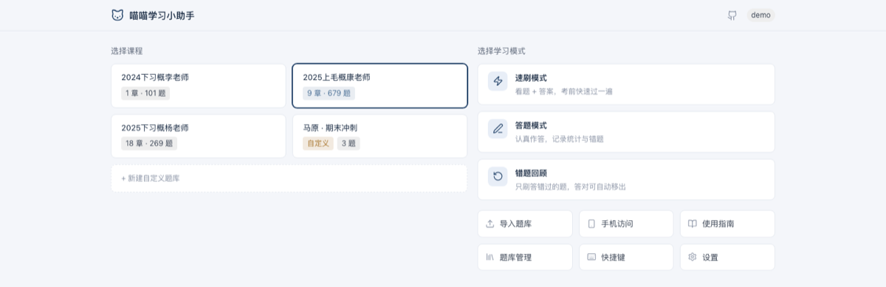
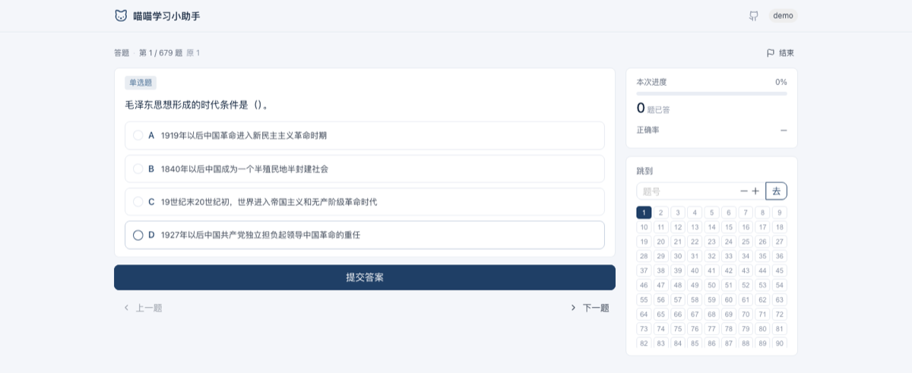
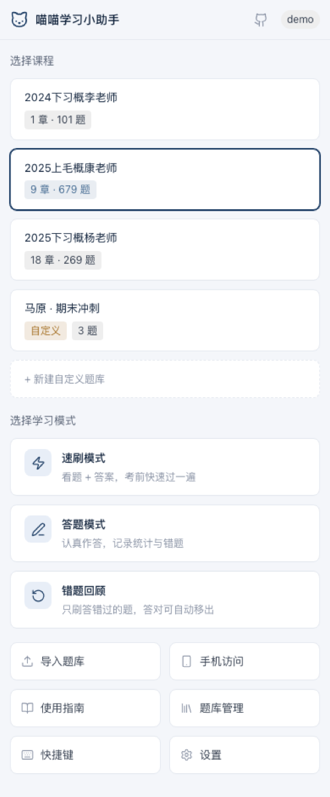
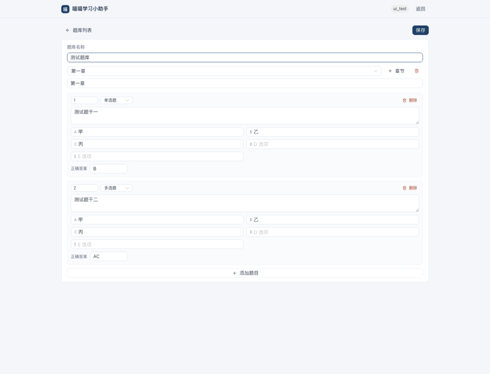

# 喵喵学习小助手

原一个基于 Go 的本地刷题工具，专为福州大学政治选择题设计，默认支持毛概和习概两门课程的选择题练习，同时支持自定义题库等功能。

## ✨ 特性

- 📚 多种答题模式（速刷、答题、错题回顾）
- 🎓 支持毛概、习概以及自定义题库
- 📊 详细的答题统计和错题管理
- 💾 本地数据持久化，支持多用户
- 🚀 单文件部署，跨平台支持
- 🌐 响应式 Web 界面（宽屏双栏 / 窄屏单列 / 手机贴底操作）
- 🐱 萌化的界面设计和交互体验

## 界面预览

主菜单：宽屏把课程和模式并排，一屏就能选完。



答题页：左边做题，右边挂进度和跳题面板。



手机端：宽度小于 768 自动切单列，操作按钮贴底。


自定义题库编辑器：



## 题库说明

- 毛概选择题：题库来源于 2025 上半学年康老师，包含 9 个章节的选择题
- 习概选择题：题库来源于 2024 下半学年李老师的题库，合计 101 道选择题，
  并新增来自 2025 下半学年杨老师的题目，合计 269 道选择题；
  章节划分为导论加 17 个章节（共 18 章节），出题老师（仅列姓氏）包括林、王、阮、潘、杨、钱、罗、黄
- 自定义

## 主要功能

- 内置题库：支持毛概、习概等课程题库。
- 多种练习模式：速刷、答题、错题回顾。
- 错题本：按课程 / 自定义题库分别记录，不会混在一起。
- 多用户本地数据：每个用户的记录、错题、设置独立保存。
- 快捷键：支持 A-E 选项、Enter、方向键、Esc，并可在设置中自定义。
- 手机访问：电脑运行后，可在同一局域网内用手机浏览器访问练习。
- 自定义题库：支持新建/编辑课程、章节、题目、选项和答案。
- JSON 导入：可直接粘贴符合格式的 JSON 题库导入为自定义题库。

## 快速开始

从 [Releases](https://github.com/ShaddockNH3/Meow-Politics-Helper/releases) 下载对应平台的文件：

- Windows：`Meow-Politics-Helper-windows-amd64.exe`（双击运行）
- Windows ARM64：`Meow-Politics-Helper-windows-arm64.exe`
- Linux：`Meow-Politics-Helper-linux-amd64.zip`
- Linux ARM64：`Meow-Politics-Helper-linux-arm64.zip`
- macOS Intel：`Meow-Politics-Helper-darwin-amd64.zip`
- macOS Apple Silicon：`Meow-Politics-Helper-darwin-arm64.zip`

Windows 用户双击 `.exe` 即可。macOS / Linux 用户解压 zip 后在终端运行：

```bash
chmod +x Meow-Politics-Helper-darwin-arm64
./Meow-Politics-Helper-darwin-arm64
```

> macOS 首次运行如果提示「无法打开，因为无法验证开发者」，先执行
> `xattr -d com.apple.quarantine Meow-Politics-Helper-darwin-arm64`
> 再运行即可（本程序为开源本地工具，未购买 Apple 签名）。

程序启动后会自动打开浏览器页面。

## 自定义题库

在首页进入“自定义题库管理”，可以：

- 新建自定义课程和章节。
- 手动增删改题目、选项、正确答案。
- 把 JSON 题库粘贴导入（生成提示词见下一节）。

JSON 导入支持标准数组格式，题目字段建议包含：

```json
[
  {
    "question_number": "AI-001",
    "question_type": "单选题",
    "question_text": "题干文本",
    "options": {"A": "选项 A", "B": "选项 B", "C": "选项 C", "D": "选项 D"},
    "correct_answer": "A"
  }
]
```

## 添加内置题库（欢迎 PR）

想贡献一门新题库？**完全不需要改 Go 代码**，两个步骤：

1. 在 `clean_outputs/` 下新建一个目录，放入章节题目文件 `0.json`、`1.json`……每个文件是一个题目数组，格式如下：

   ```json
   [
     {
       "question_number": "1",
       "question_type": "单选题",
       "question_text": "题干文本",
       "options": {"A": "选项 A", "B": "选项 B", "C": "选项 C", "D": "选项 D"},
       "correct_answer": "C"
     }
   ]
   ```

2. 在同一目录放一个 `meta.json`：

   ```json
   {
     "key": "maogai_2026",
     "name": "2026 上毛概某某老师",
     "max_chapter": 8
   }
   ```

   - `key`：题库唯一标识，只能用小写字母、数字、下划线和短横线。
   - `name`：界面上显示的名称。
   - `max_chapter`：最大章节号，**可省略**——省略时程序自动扫描 `0.json`、`1.json`… 直到缺文件为止。
   - `chapter_names`（可选）：章节名映射，如 `{"0": "导论"}`。

提交 PR 前跑一下 `go test ./...` 即可，程序启动时会自动发现并加载所有题库目录。

## AI 生成题库（外部）

本工具已移除内置 AI 接口，改用「外部生成 + 本地导入」的方式：

1. 在「导入题库（粘贴 JSON）」页面复制**生成提示词**。
2. 把提示词连同你的学习材料一起发给任意 AI（网页版对话即可）。
3. AI 会返回题库 JSON，人工检查后粘贴导入为自定义题库。

JSON 导入支持标准数组格式，题目字段建议包含：

```json
[
  {
    "question_number": "AI-001",
    "question_type": "单选题",
    "question_text": "题干文本",
    "options": {"A": "选项 A", "B": "选项 B", "C": "选项 C", "D": "选项 D"},
    "correct_answer": "A"
  }
]
```

AI 生成的题目建议人工检查后再导入。

## 手机访问

程序运行后，在页面中打开“手机访问”即可看到局域网地址。手机和电脑需要连接到同一个网络；如果打不开，请检查防火墙或网络隔离设置。

## 本地数据

用户数据默认保存在项目运行目录下的 `user_data/`：

- 用户配置和练习记录。
- 错题本。
- 自定义题库。

发版或分享程序时，不要把自己的 `user_data/` 一起打包。

## 开发构建

需要 Go 1.24+ 和 Node.js 20+。

```bash
make build      # 先构建前端（web/dist），再编译 Go 二进制
make test       # 只跑 Go 测试（需要先构建过前端）
make dev        # 前端开发服务器，/api 自动代理到 8899
```

手动等价命令：

```bash
cd web && npm install && npm run build && cd ..
go test ./...
go build -o Meow-Politics-Helper .
```

前端是 Vue 3 + Vite + Naive UI，构建产物在 `web/dist/`，由 `go:embed` 打进二进制——所以**改前端后必须重新构建前端再编译 Go**，否则跑的还是旧页面。

代码结构：

```text
main.go                  启动装配：内置题库自动发现、依赖组装、路由注册
web/                     前端工程（Vue 3 + Vite + Naive UI）
  src/views/             页面：主菜单、答题、题库编辑器等
  src/components/        AppShell 等外壳组件
  src/stores/app.js      全局状态与业务动作
  src/api.js             接口封装
internal/store/          用户数据持久化（路径校验、原子写入）
internal/course/         题目/题库模型、课程注册表、JSON 导入解析、内置题库加载
internal/quiz/           刷题业务：选题、服务端判分、错题本、统计
internal/session/        内存用户会话
internal/service/        自定义题库业务（导入、编辑、删除）
internal/httpapi/        HTTP handler 与路由
```

构建后运行生成的可执行文件即可。

## 许可证

本项目使用 MIT License，详见 [LICENSE](LICENSE)。

## 反馈

欢迎通过 GitHub Issues 反馈问题或建议：

**🎉 祝学习愉快！**
