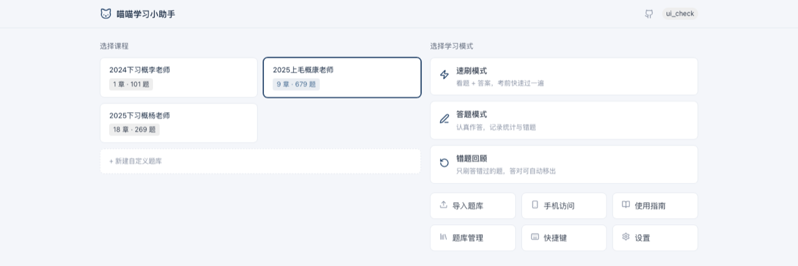
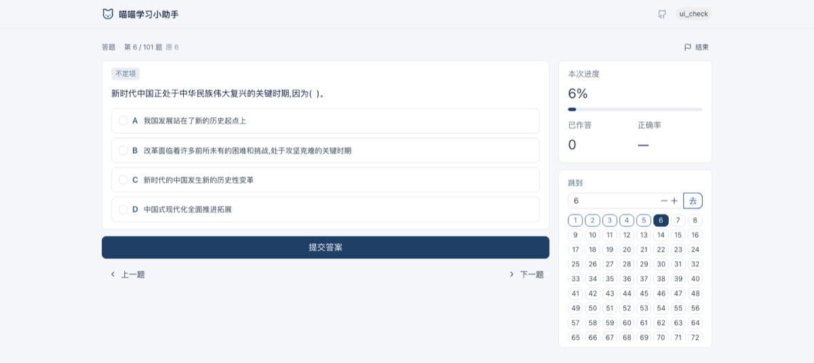
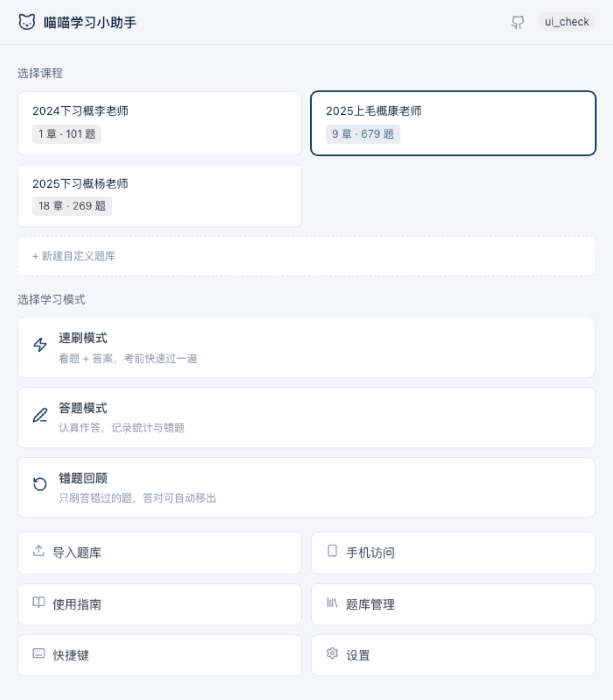
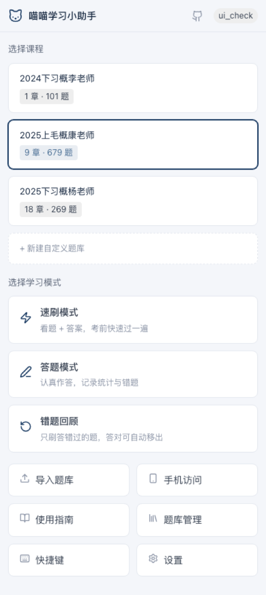
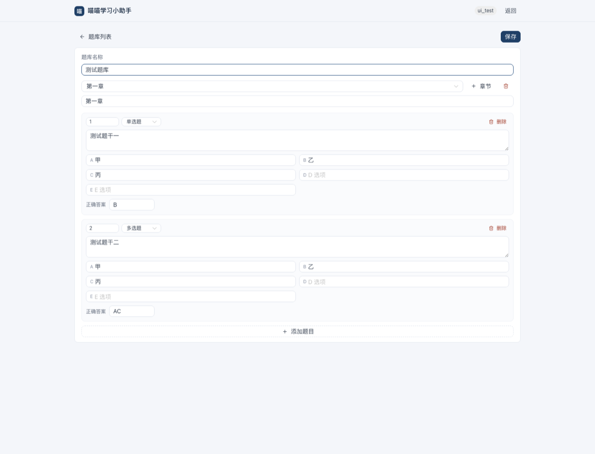

# 喵喵学习小助手

一个基于 Go 的本地刷题工具，专为福州大学政治选择题设计，默认支持毛概和习概两门课程的选择题练习，同时支持自定义题库等功能。

## ✨ 特性

- 📚 多种答题模式（速刷、答题、错题回顾），支持单选、多选、不定项
- 🎓 支持毛概、习概以及自定义题库
- 📊 详细的答题统计和错题管理
- 💾 本地数据持久化，支持多用户
- 🚀 单文件部署，跨平台支持
- 🌐 响应式 Web 界面（宽屏双栏 / 窄屏单列 / 手机贴底操作）
- 🐱 萌化的界面设计和交互体验

## 界面预览

主菜单（宽屏）：课程和模式并排，一屏就能选完。



答题页（宽屏）：左边做题，右边挂进度和跳题面板。



窄屏（约 700px，落在 768 断点以下）：课程和模式改为上下堆叠，宽度仍够放两列卡片。



手机（390px）：单列布局，操作按钮贴底。



自定义题库编辑器：



## 快速开始

### 先选对文件

| 你的电脑                   | 下载这个                                     |
| ---------------------- | ---------------------------------------- |
| Windows（绝大多数）          | `Meow-Politics-Helper-windows-amd64.exe` |
| Windows ARM（骁龙本）       | `Meow-Politics-Helper-windows-arm64.exe` |
| macOS（Apple 芯片 M1 及以后） | `Meow-Politics-Helper-darwin-arm64.zip`  |
| macOS（Intel 芯片）        | `Meow-Politics-Helper-darwin-amd64.zip`  |
| Linux（x86_64）          | `Meow-Politics-Helper-linux-amd64.zip`   |
| Linux（ARM64 / 树莓派）     | `Meow-Politics-Helper-linux-arm64.zip`   |

不确定自己是哪种架构：

- macOS：苹果菜单 → 关于本机 → 看「芯片」，Apple M 开头选 arm64，Intel 选 amd64
- Windows：设置 → 系统 → 关于 → 看「系统类型」，x64 选 amd64，ARM 选 arm64
- Linux：终端执行 `uname -m`，`x86_64` 选 amd64，`aarch64` 选 arm64

### Windows

1. 下载 `Meow-Politics-Helper-windows-amd64.exe`，放到桌面或任意文件夹
2. 双击运行
3. 首次运行如果弹出「Windows 已保护你的电脑」，点「更多信息」→「仍要运行」
4. 浏览器会自动打开 `http://localhost:8899`，没打开就手动访问
5. 关闭命令行窗口即退出程序

> 不要放在 `C:\Program Files` 这类需要管理员权限的目录，程序要在同目录创建 `user_data/`。

### macOS

1. 下载 zip，双击解压
2. 打开「终端」，进入解压目录并运行：

   ```bash
   cd ~/Downloads
   chmod +x Meow-Politics-Helper-darwin-arm64
   xattr -d com.apple.quarantine Meow-Politics-Helper-darwin-arm64
   ./Meow-Politics-Helper-darwin-arm64
   ```

3. 浏览器自动打开；`Ctrl+C` 或关闭终端窗口即退出

如果解压后双击提示「无法打开」，也可以去「系统设置 → 隐私与安全性」，在底部点「仍要打开」。

### Linux

```bash
unzip Meow-Politics-Helper-linux-amd64.zip
chmod +x Meow-Politics-Helper-linux-amd64
./Meow-Politics-Helper-linux-amd64
```

- 工作目录要放在有写权限的位置，程序会在同目录创建 `user_data/`

#### 用 tmux 托管（推荐）

如果不使用托管工具进行管理，断掉 ssh 终端后服务便会停止。

```bash
sudo apt install tmux      # Debian / Ubuntu
sudo dnf install tmux      # Fedora
sudo pacman -S tmux        # Arch
```

然后在 tmux 里启动程序：

```bash
tmux new -s quiz                    # 新建名为 quiz 的会话
./Meow-Politics-Helper-linux-amd64  # 在会话里运行
```

程序跑起来后，按 `Ctrl+B` 松开，再按 `D`，程序继续在后台运行，人可以放心断开 SSH。

下次回来：

```bash
tmux ls                  # 看有哪些会话在跑
tmux attach -t quiz      # 接回名为 quiz 的会话
```

用完想彻底关掉（会话里 `Ctrl+C` 停程序再 `exit` 也行）：

```bash
tmux kill-session -t quiz
```

服务器上部署的话，浏览器访问 `http://服务器IP:8899` 即可（`localhost` 只在服务器本机有效）。  
打不开先检查防火墙和云服务商安全组有没有放行 8899 端口。

### 第一次打开

1. 输入用户 ID（字母、数字、下划线，1–50 位），点「进入」
2. 选课程 → 选学习模式 → 选章节 → 开始
3. 数据保存在程序同目录的 `user_data/`，换电脑时把整个目录拷过去即可

### 常见问题

| 现象              | 处理                           |
| --------------- | ---------------------------- |
| 端口被占用           | 先退出已经开着的本程序，再重新启动            |
| 浏览器没自动打开        | 手动访问 `http://localhost:8899` |
| macOS 提示无法验证开发者 | 执行上面的 `xattr` 命令             |
| 双击后被文本编辑器打开     | 缺执行权限，用终端 `chmod +x` 后再运行    |
| 手机也想用           | 电脑保持运行，页面点「手机访问」拿局域网地址       |

## 题库说明

- 毛概选择题：题库来源于 2025 上半学年康老师，包含 9 个章节的选择题
- 习概选择题：题库来源于 2024 下半学年李老师的题库，合计 101 道选择题，  
  并新增来自 2025 下半学年杨老师的题目，合计 269 道选择题；  
  章节划分为导论加 17 个章节（共 18 章节），出题老师（仅列姓氏）包括林、王、阮、潘、杨、钱、罗、黄
- 习概选择题（2025 下李老师）：与上一份独立成库的另一套题，合计 272 道选择题，  
  章节划分同为导论加 17 个章节（共 18 章节）
- 自定义

## 自定义题库

在首页进入“自定义题库管理”，可以：

- 新建自定义课程和章节。
- 手动增删改题目、选项、正确答案。
- 把 JSON 题库粘贴导入（生成提示词见下一节）。

JSON 导入支持标准数组格式，题目字段建议包含：

```json
[
  {
    "question_number": "AI-001",
    "question_type": "单选题",
    "question_text": "题干文本",
    "options": {"A": "选项 A", "B": "选项 B", "C": "选项 C", "D": "选项 D"},
    "correct_answer": "A"
  }
]
```

## 添加内置题库（欢迎 PR）

想贡献一门新题库？**完全不需要改 Go 代码**，两个步骤：

1. 在 `clean_outputs/` 下新建一个目录，放入章节题目文件 `0.json`、`1.json`……每个文件是一个题目数组，格式如下：

   ```json
   [
     {
       "question_number": "1",
       "question_type": "单选题",
       "question_text": "题干文本",
       "options": {"A": "选项 A", "B": "选项 B", "C": "选项 C", "D": "选项 D"},
       "correct_answer": "C"
     }
   ]
   ```

2. 在同一目录放一个 `meta.json`：

   ```json
   {
     "key": "maogai_2026",
     "name": "2026 上毛概某某老师",
     "max_chapter": 8
   }
   ```

   - `key`：题库唯一标识，只能用小写字母、数字、下划线和短横线。
   - `name`：界面上显示的名称。
   - `max_chapter`：最大章节号，**可省略**——省略时程序自动扫描 `0.json`、`1.json`… 直到缺文件为止。
   - `chapter_names`（可选）：章节名映射，如 `{"0": "导论"}`。

提交 PR 前跑一下 `go test ./...` 即可，程序启动时会自动发现并加载所有题库目录。

## AI 生成题库（外部）

本工具已移除内置 AI 接口，改用「外部生成 + 本地导入」的方式：

1. 在「导入题库（粘贴 JSON）」页面复制**生成提示词**。
2. 把提示词连同你的学习材料一起发给任意 AI（网页版对话即可）。
3. AI 会返回题库 JSON，人工检查后粘贴导入为自定义题库。

JSON 导入支持标准数组格式，题目字段建议包含：

```json
[
  {
    "question_number": "AI-001",
    "question_type": "单选题",
    "question_text": "题干文本",
    "options": {"A": "选项 A", "B": "选项 B", "C": "选项 C", "D": "选项 D"},
    "correct_answer": "A"
  }
]
```

AI 生成的题目建议人工检查后再导入。

## 手机访问

程序运行后，在页面中打开“手机访问”即可看到局域网地址。手机和电脑需要连接到同一个网络；如果打不开，请检查防火墙或网络隔离设置。

## 本地数据

用户数据默认保存在项目运行目录下的 `user_data/`：

- 用户配置和练习记录。
- 错题本。
- 自定义题库。

发版或分享程序时，不要把自己的 `user_data/` 一起打包。

## 开发构建

需要 Go 1.24+ 和 Node.js 20+。

```bash
make build      # 先构建前端（web/dist），再编译 Go 二进制
make test       # 只跑 Go 测试（需要先构建过前端）
make dev        # 前端开发服务器，/api 自动代理到 8899
```

手动等价命令：

```bash
cd web && npm install && npm run build && cd ..
go test ./...
go build -o Meow-Politics-Helper .
```

前端是 Vue 3 + Vite + Naive UI，构建产物在 `web/dist/`，由 `go:embed` 打进二进制——所以**改前端后必须重新构建前端再编译 Go**，否则跑的还是旧页面。

代码结构：

```text
main.go                  启动装配：内置题库自动发现、依赖组装、路由注册
web/                     前端工程（Vue 3 + Vite + Naive UI）
  src/views/             页面：主菜单、答题、题库编辑器等
  src/components/        AppShell 等外壳组件
  src/stores/app.js      全局状态与业务动作
  src/api.js             接口封装
internal/store/          用户数据持久化（路径校验、原子写入）
internal/course/         题目/题库模型、课程注册表、JSON 导入解析、内置题库加载
internal/quiz/           刷题业务：选题、服务端判分、错题本、统计
internal/session/        内存用户会话
internal/service/        自定义题库业务（导入、编辑、删除）
internal/httpapi/        HTTP handler 与路由
```

构建后运行生成的可执行文件即可。

## 许可证

本项目使用 MIT License，详见 [LICENSE](LICENSE)。

## 反馈

欢迎通过 GitHub Issues 反馈问题或建议：

**🎉 祝学习愉快！**
